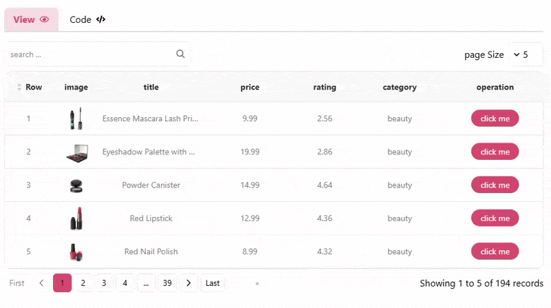

# React Responsive DataTable Kit

A responsive data table for React 18 and 19, with desktop tables, mobile cards,
static or server data, search, sorting, pagination, selection and Persian/RTL.

[Live demo](https://fatemeh-bd.github.io/responsive-react-datatable/) ·
[Migration notes](https://github.com/fatemeh-bd/responsive-react-datatable/blob/main/CHANGELOG.md)



Recorded interaction preview. The live examples in the documentation demonstrate
the current release, including column visibility, file exports and row details.

## Choose your documentation version

Open the [versioned documentation](https://fatemeh-bd.github.io/responsive-react-datatable/#/document)
and select the version installed in your project. Check it with:

```sh
npm ls react-responsive-datatable-kit
```

Each version has its own guide, examples and change notes. Archived documentation
does not change when a new major version is released. Live playgrounds are shown
only when they match the version running in the documentation site.

## Install

```sh
npm install react-responsive-datatable-kit @tanstack/react-query
```

React and React DOM must use matching supported versions (`^18.0.0 || ^19.0.0`).
TanStack Query v5 is a peer dependency; npm 7+ installs peers automatically, but
listing it in your app explicitly helps share a single QueryClient context.
This package is ESM. Future React major versions require separate verification.

Import the stylesheet once in your application entry:

```tsx
import "react-responsive-datatable-kit/styles.css";
```

Version 3 extracts and scopes CSS instead of injecting it into the document.
No Tailwind installation is required.

## Quick start: static rows

This example works in a React/Vite application without a QueryClientProvider or
Tailwind. Supply the complete rows array; filtering, sorting and pagination run
locally.

```tsx
import Table, { type ColumnType } from "react-responsive-datatable-kit";
import "react-responsive-datatable-kit/styles.css";

const columns: ColumnType[] = [
  { data: "name", title: "Name", searchable: true, orderable: true },
  { data: "age", title: "Age", orderable: true },
];
const rows = [{ id: 0, name: "Amy", age: 30 }, { id: 1, name: "Bob", age: 24 }];

export default function People() {
  return <Table mode="static" columns={columns} staticRows={rows} pageSize={10} />;
}
```

Static mode derives the count from the supplied rows. Input order is preserved
until sorted; the third sort click restores input order. Local search respects
`searchable: false`. Searching resets the page. Sorting works with `noSearch`.
Search has one clear button, which resets immediately. Sort indicators are compact.
The table prepends a row-number column, as in previous releases.

## Choose a data mode

| Mode | Give the table | What the table manages | Best fit |
| --- | --- | --- | --- |
| `static` | The complete `staticRows` array | Local search, sorting, count and pagination | Small/medium in-memory datasets |
| `internal` | `internalApiConfig` and the documented API response | Requests, cancellation, cache, loading and interaction state | A compatible paginated endpoint |
| `external` | The loaded `externalRows`, `totalItems`, loading and callbacks | Rendering and interaction callbacks | Your own fetching layer or custom API protocol |

All three modes support column visibility, row details and file exports. In server
modes, the table only has the loaded page unless you supply `exportConfig.getRows`.

## Next.js

Import the stylesheet in `app/layout.tsx` (App Router) or `pages/_app.tsx` (Pages
Router). The published entry preserves `"use client"` and supports server
prerendering without disabling SSR.

Plain serializable columns/rows can be passed from a Server Component. When
columns use render functions or you pass event callbacks, define those in a
Client Component:

```tsx
"use client";
import Table, { rowRenderer, type ColumnType } from "react-responsive-datatable-kit";
const columns: ColumnType[] = [
  { data: "name", title: "Name" },
  { data: null, title: "Action", render: rowRenderer((_cell, row) =>
    <button type="button" onClick={() => alert(row.name)}>View</button>) },
];
export default function PeopleTable() {
  return <Table mode="static" columns={columns} staticRows={[{ id: 0, name: "Amy" }]} />;
}
```

See the repository's `docs/release-verification.json` for exact tested React/Next
versions. Only the pairs in that report have been verified; this is not a promise
of compatibility with every historical or future Next release.

## Internal API mode

```tsx
import Table from "react-responsive-datatable-kit";

<Table mode="internal" tableName="people" columns={columns}
  internalApiConfig={{
    endpoint: "/api/people",
    method: "POST",
    defaultSortBy: "id",
    sortType: "desc",
    customBody: [{ active: true, isFilter: true }],
  }}
  notify={(message, type) => console.log(type, message)}
/>;
```

The table uses a surrounding QueryClientProvider when present, otherwise a
private client. Requests are cancelled when obsolete. Query data/loading/errors
are derived from the active request, including fresh cached results.
Failed requests display an accessible error message and a **Try again** button,
even without `notify`. Customize these with `textsConfig.errorText` and
`textsConfig.retryText`; `notify` remains available for your own notifications.
GET sends query parameters; POST sends JSON data. `baseUrl` is optional, and
absolute endpoints are supported. Never pass private server credentials through
client props.

Request body/query parameters use a DataTables-like shape:

```ts
{
  draw: currentPage,
  columns: [{ data, name, searchable, orderable, search: { value: "", regex: false, fixed: [] } }],
  order: [{ column: 0, name: "id", dir: "desc" }],
  start: (currentPage - 1) * pageSize,
  length: pageSize,
  search: { value: searchText, regex: false, fixed: [] },
}
```

The server response must be an object with `data` (an array, or null to signal an
empty warning response) and `recordsFiltered` (the total count after filtering).
`onFetch` receives that response. `customBody` fields are merged into the request;
`noRefresh` and `isFilter` are metadata and are not sent. `noRefresh: true` means
changes to that item alone do not refetch. `payload` replaces the generated
payload when provided.

## External API mode

The host owns fetching and passes the loaded page, total count and loading flag:

```tsx
<Table mode="external" columns={columns} externalRows={rows} totalItems={total}
  isLoading={loading} onPageChange={setPage} onPageSizeChange={setPageSize}
  onSearch={setSearch} onSortChange={setOrder} />
```

Callbacks also notify the host when search/sizing resets the page or a deep-linked
page or page size is restored. `onPageSizeChange` also runs when the effective
size changes through browser navigation or automatic sizing; it fires once per
size change. Pass stable row IDs with `rowKey` when data does not use `id`.

## Public API

Default export and named `Table` refer to the same component. Also exported:
`rowRenderer`, `ActionDropDown`, and public table/configuration/selection types.

| Prop | Default / behavior |
| --- | --- |
| `mode` | Required: `static`, `external` or `internal` |
| `columns` | Required `ColumnType[]`; `data: null` for action cells |
| `staticRows` | All rows in static mode |
| `externalRows`, `totalItems` | Loaded page and server count in external mode |
| `internalApiConfig` | Required in internal mode |
| `pageSize` | 10; positive integer; prop updates are respected unless URL overrides it |
| `pageQueryName`, `pageSizeQueryName` | `page`, `pageSize`; use distinct names for independent tables |
| `tableName` | Optional; identifies query cache and saved search; use a stable unique name |
| `rowKey` | `id`; a field name or `(row) => string | number`; stable IDs are recommended |
| `isSelectable` | false; provide `selectedIds` and `onSelectChange` when enabled |
| `selectedKey` | `id`; supports string/number IDs, including zero |
| `onSelectChange` | Controlled selection callback; update your `selectedIds` state |
| `noSearch`, `noPageSize` | Hide the respective controls |
| `saveSearch` | false; optional sessionStorage persistence, requires `tableName` |
| `lang` | `en`; `fa` enables Persian labels and RTL |
| `textsConfig`, `colorTheme` | Override texts/colors; see exported types |
| `theme` | `light` by default; white rows with soft-black text/controls. Also accepts `dark` or a hex color |
| `className`, `style` | Additional root class and inline styles; built-in classes are preserved |
| `height` | Desktop maximum scroll height, e.g. `70vh` |
| `startMobileSize` | 768; mobile cards below this width |
| `listMode` | false; use a mobile list instead of swipe cards |
| `autoPageSizeConfig` | Disabled by default; containerSelector, rowHeight, subtractSelectors and row buffers |
| `columnNumber` | Optional override for the initial request sort index; otherwise derived from `defaultSortBy` |
| `rowClassName` | `(row) => string`; applied to desktop rows and mobile cards |
| `filters`, `topFilter`, `actionButtons` | Host-owned content slots |
| `onClearFilters` | Reset host-owned filters; clearing no longer reloads the app |
| `removeFilterKey` | Optional sessionStorage key removed when clearing filters |
| `notify`, `isLoading` | Request notifications / host loading state |
| `onPageChange`, `onPageSizeChange`, `onSearch`, `onSortChange` | Interaction callbacks |
| `columnVisibility` | false; show the column chooser |
| `hiddenColumnIds`, `onHiddenColumnsChange` | Optional controlled column visibility |
| `defaultHiddenColumnIds` | Initial hidden column IDs for uncontrolled visibility |
| `exportConfig` | false; `true` enables CSV, Excel and PDF, or pass an `ExportConfig` |
| `expandableRows` | Optional renderer and expanded-row state; see the example below |

Select-all includes all filtered static rows, or the loaded server page. It keeps
selected IDs outside that scope. Mobile sorting has no built-in header control;
server-side sorting can be provided by host-owned controls.

## Show and hide columns

```tsx
const columns: ColumnType[] = [
  { data: "name", title: "Name", hideable: false },
  { data: "email", title: "Email", hidden: true },
  { id: "actions", data: null, title: "Actions", exportable: false,
    render: rowRenderer((_cell, row) => <button type="button">View {row.name}</button>) },
];

<Table mode="static" columns={columns} staticRows={rows} columnVisibility />;
```

The **Columns** button opens an accessible chooser on desktop and mobile.
`hidden: true` sets the initial visibility; `hideable: false` locks its checkbox.
IDs default to the `data` field, or `column-{index}` for `data: null`. Give action
columns a stable `id`, and use unique IDs when fields repeat.

For controlled visibility, supply `hiddenColumnIds` and update it in
`onHiddenColumnsChange`. The default props are read at mount. Hiding a column
changes presentation, not the request schema or search pipeline; use
`searchable: false` if that field should not be searched.

## Export CSV, Excel or PDF

```tsx
<Table mode="static" columns={columns} staticRows={rows} columnVisibility
  exportConfig={{ fileName: "people", formats: ["csv", "xlsx", "pdf"] }} />;
```

Choose **Export**, a row scope, whether to include hidden columns, and the file
format. Excel produces a real `.xlsx` workbook with numeric/boolean cells and a
frozen header. CSV uses UTF-8 with a BOM, quotes cells and neutralizes formula-like
text. PDF uses a bundled, freely licensed font for Latin and Persian/Arabic text;
wide tables can continue across pages. Export code is loaded when requested.

| Option | Default / meaning |
| --- | --- |
| `formats` | `["csv", "xlsx", "pdf"]`; restrict the available buttons |
| `fileName` | `table-export`; extension is added automatically |
| `scope` | `filtered` in static mode; `page` in server modes without `getRows` |
| `includeHiddenColumns` | false; users can change this in the export dialog |
| `getRows(context)` | Optional async data source for the chosen export scope |
| `onError(error)` | Optional additional error handling; the dialog also shows a retryable error |

Only your data columns are exported; built-in selection, numbering and detail
controls are excluded. Action columns (`data: null`) are excluded unless they
provide `exportValue`. Set `exportable: false` to exclude a field in every format.
React renderers are not used for export. Use `exportValue` for formatted data:

```tsx
{ data: "status", title: "Status",
  render: rowRenderer(cell => <strong>{String(cell)}</strong>),
  exportValue: row => row.status === "active" ? "Active" : "Inactive" }
```

Return a string, number, boolean, Date, null or undefined. Dates export as ISO text.
The bundled PDF font covers Latin and Persian/Arabic, not every Unicode script.

### Row scopes and server exports

- **All filtered rows:** the filtered, sorted static dataset, across all pages.
- **Current page:** the currently loaded/displayed rows.
- **Selected rows:** selected rows that are available in the dataset being exported.

Server mode does not silently fetch every page. Its dialog explains the loaded-row
limit. To export all matches or selected IDs from other pages, provide `getRows`:

```tsx
exportConfig={{
  fileName: "people",
  scope: "filtered",
  getRows: async ({ scope, search, order, page, pageSize, selectedIds }) => {
    const response = await fetch("/api/people/export", {
      method: "POST",
      headers: { "Content-Type": "application/json" },
      body: JSON.stringify({ scope, search, order, page, pageSize, selectedIds }),
    });
    if (!response.ok) throw new Error("Export request failed");
    const body = await response.json();
    return body.data; // array of rows, not a file or a DataTables envelope
  },
}}
```

This export endpoint is implemented by your application. It should honor the
requested scope. `selected` exports are also filtered against `selectedIds` using
`selectedKey`; IDs must use matching string/number types. Export is generated in
the browser, so use an application-owned export flow for datasets too large to
load into memory.

## Expand row details

```tsx
<Table mode="static" columns={columns} staticRows={rows} rowKey="id"
  expandableRows={{
    render: row => <section>
      <h3>{row.name}</h3>
      <p>{row.email}</p>
      <p>{row.notes}</p>
    </section>,
    canExpand: row => Boolean(row.notes),
    defaultExpandedRowIds: [0],
  }} />;
```

Desktop shows a full-width detail row below its parent. Mobile shows the same
content inside the card. Details are rendered only when expanded. The toggle
uses a small downward chevron, rotating upward while open. It
supports keyboard activation and exposes `aria-expanded` / `aria-controls`.

Stable string/number IDs are required. Use `rowKey` when your data has no `id`;
rows without a valid ID have no expansion toggle. ID `0` is supported. Expanded
state follows the ID when sorting or changing pages, and is shared between desktop
and mobile. Controlled state uses `expandedRowIds` and `onExpandedChange` inside
`expandableRows`; otherwise use `defaultExpandedRowIds`.

## Loading states

```tsx
<Table mode="external" columns={columns} externalRows={rows} totalItems={total}
  isLoading={loading} />
```

Loading placeholders use the same column widths and row height as the data.
The animation changes opacity only, so it does not expand into the horizontal
scroll area. Desktop reserves a stable scrollbar gutter. Reduced-motion settings
disable the animation.

## Column reference

| Property | Type / default | Purpose |
| --- | --- | --- |
| `data` | `string` or `null`, required | Row field, or a custom action cell |
| `title` | `string`, required | Header and mobile label |
| `id` | `string`, derived by default | Stable visibility ID |
| `render` | `(cell, row, index) => ReactNode` | Custom presentation; `rowRenderer` helps with existing callback types |
| `width` | `number`, optional | Desktop column width in pixels |
| `orderable` | `boolean`, false | Enable the desktop sorting control |
| `searchable` | `boolean` | Local search includes fields unless false; API requests send the explicit flag |
| `hidden` | `boolean`, false | Initial hidden state |
| `hideable` | `boolean`, true | Whether the chooser can toggle the column |
| `exportable` | `boolean`, true for data fields | Include the column in file exports |
| `exportValue` | `(row) => ExportCellValue` | Export a plain value independently of `render` |
| `dontShowTitleInMobile` | `boolean`, false | Hide the mobile field label |
| `dontShowDataInMobile` | `boolean`, false | Hide this field in cards; desktop visibility is unchanged |

## Themes and custom styles

```tsx
<Table mode="static" columns={columns} staticRows={rows}
  theme="#000"
  className="people-table"
  style={{ padding: 16, borderRadius: 16 }}
  rowClassName={row => row.status === "inactive" ? "muted-person" : undefined}
/>
```

The table defaults to light mode: white rows, a pale-gray header, and soft-black
text and controls. For another palette, pass a hex color such as `theme="#121212"`.
It sets the table's base surface and derives readable text, header, borders and
controls automatically; it is not just an accent color. Use `theme="light"` for
a white table. `dark` is also accepted. `colorTheme` optionally overrides individual colors.
The root exposes the supplied value in `data-theme` for your CSS.

| `colorTheme` key | Controls |
| --- | --- |
| `primaryColor` | Selected checkboxes and active pagination |
| `primaryTextColor` | Text/checkmarks on the primary color; contrast is derived when omitted |
| `borderColor` | Table and control borders |
| `backgroundColor` | Row, card and dialog surfaces |
| `headerBackgroundColor` | Desktop header background |
| `headerTextColor` | Header and mobile label text |
| `cellTextColor` | Data and control text |

Use `className` and `style` for the root layout and your own CSS selectors. Use
`rowClassName` for desktop rows and mobile cards. Built-in colors are inline, so
prefer `colorTheme` for color changes. Dialogs are portalled to `document.body`;
they receive theme colors, but are not descendants of your custom root class.

```css
.people-table { margin-block: 24px; }
.people-table .desktop-table-data-cell { padding-block: 14px; }
.people-table .muted-person { opacity: 0.65; }
```

## Common setup issues

| Symptom | What to check |
| --- | --- |
| Table is unstyled | Import `react-responsive-datatable-kit/styles.css` once; in Next, use the root layout or `_app.tsx` |
| Next rejects function props | Put render functions and callbacks inside a component marked `"use client"` |
| Two tables change pages together | Give each table distinct `pageQueryName` and `pageSizeQueryName` values |
| Selection or state follows the wrong row | Use stable, unique IDs; configure `rowKey` and `selectedKey` for your data |
| API mode cannot show results | Return `{ data: [...], recordsFiltered: total }`; external mode expects the loaded page and the filtered total separately |

## Development and release

Use Node 20.19+ and npm 10+. The npm lockfile is authoritative.

```sh
npm ci
npm test
npm run build
npm run test:package
npm run test:release
npm run build:demo
```

Library output is `dist/`; demo output is `demo-dist/`. `npm run deploy` deploys
only the demo. The release matrix installs the actual tarball into isolated
React/Next consumers and uses Playwright Chromium (or `RELEASE_CHROME_PATH`).
For Windows PowerShell, use `npm.cmd` if execution policy blocks `npm.ps1`.

Maintainers/AI: start with [AGENTS.md](https://github.com/fatemeh-bd/responsive-react-datatable/blob/main/AGENTS.md)
and `docs/MAINTAINER-README.md`. The original audit is historical; consult the
release verification and changelog for the stabilized version.

MIT License.
